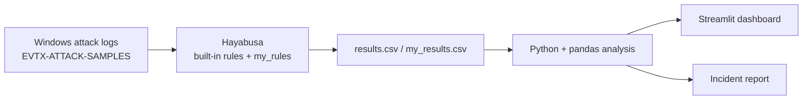

# AttackLens: MITRE ATT&CK-Mapped Threat Detection Pipeline
# Link : https://attacklens-vfhzk2egsvdex5vqqsww5r.streamlit.app/

A detection pipeline that scans real Windows attack logs with Hayabusa, adds my own custom detection rules, maps every alert to MITRE ATT&CK, and shows the results in a Streamlit dashboard. It also includes a full incident report on one simulated attack.

## Results at a glance
- **5,388 alerts** produced from the public EVTX-ATTACK-SAMPLES dataset (25 critical, 611 high)
- **5 custom detection rules** written by me, all of which fired on real attack data (53 hits in total)
- **1 incident investigated end to end:** a UAC bypass (UACMe method 34) on host MSEDGEWIN10
- **Interactive dashboard** with severity, MITRE technique, computer and timeline views

## How it works


## Tools used
Hayabusa 4.2.0, Sigma-style detection rules (YAML), Python (pandas), Streamlit, MITRE ATT&CK, GitHub Codespaces.

## Dashboard


## My custom detection rules
| Rule | Event ID | MITRE | Hits |
|------|----------|-------|------|
| Security Event Log Cleared | 1102 | T1070.001 | 24 |
| Whoami Reconnaissance Command | Sysmon 1 | T1033 | 22 |
| New Service Installed | 7045 | T1543.003 | 4 |
| User Added To Local Administrators Group | 4732 | T1098 | 2 |
| Failed Logon Attempt | 4625 | T1110 | 1 |

Rule files are in [`my_rules/`](my_rules/).

## Incident report
[INCIDENT_REPORT.md](INCIDENT_REPORT.md) covers a UAC bypass: the attacker tool UACME.exe edits the `windir` registry value, triggers the SilentCleanup scheduled task, and gets a High-integrity command prompt with no UAC prompt. Four alerts fired within 1.2 seconds, three of them mapped to T1548.002.

Other files: [notes.md](notes.md) explains five serious detections (what the attack is, what the attacker wants, how to stop it).

## How to run it yourself
```bash
git clone https://github.com/JayPatel199/attacklens.git
cd attacklens
git clone https://github.com/sbousseaden/EVTX-ATTACK-SAMPLES.git
```
Download Hayabusa 4.2.0 (Linux x64 build) from https://github.com/Yamato-Security/hayabusa/releases into a `hayabusa/` folder, then:
```bash
cd hayabusa
chmod +x hayabusa-4.2.0-lin-x64-gnu
./hayabusa-4.2.0-lin-x64-gnu update-rules
./hayabusa-4.2.0-lin-x64-gnu dfir-timeline -d ../EVTX-ATTACK-SAMPLES -o ../results.csv -p verbose -b -w -C -U
./hayabusa-4.2.0-lin-x64-gnu dfir-timeline -d ../EVTX-ATTACK-SAMPLES -r ../my_rules -o ../my_results.csv -p verbose -b -w -C -U
cd ..
pip install pandas streamlit
streamlit run app.py
```

## What I learned
- How a detection rule works: log channel, event ID, condition, severity, MITRE tag
- Why severity filtering matters: most of the 5,388 alerts were low-value informational noise
- Several different rules flagging one technique gives more confidence than a single alert
- Writing an incident report: timeline, indicators of compromise, recommendations

## Limitations and next steps
- Logs are from a public dataset, not a live network
- A failed-logon rule is only useful with a threshold (many failures in a short time)
- Next: add a rule for the `windir` registry change seen in the UAC bypass, and load alerts into a SIEM such as Wazuh or Elastic

Data: [EVTX-ATTACK-SAMPLES](https://github.com/sbousseaden/EVTX-ATTACK-SAMPLES). Detection engine: [Hayabusa](https://github.com/Yamato-Security/hayabusa).
